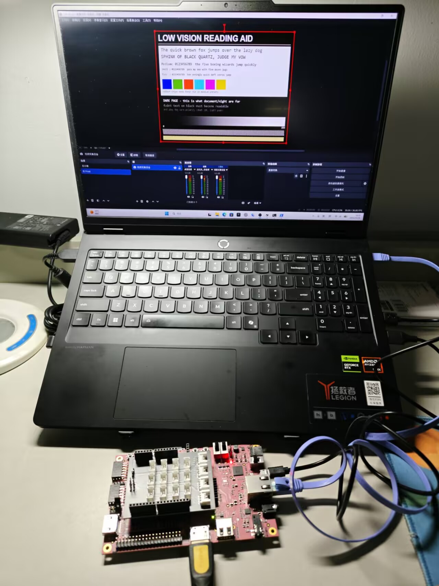

# 低延迟视觉增强终端

面向低照度图像观察的低延迟视觉增强终端，运行在 PYNQ-Z2（Zynq-7000 XC7Z020）上。

整条增强链放在可编程逻辑的像素流里，**不经过帧缓冲**，像素进多少出多少；片上双时间戳实测流水线延迟
**16 个像素时钟 = 160 ns**，约为 720p60 一行时间的 1%。同一颗内核既能在 HDMI 通路上以 640×480@60
持续出图，也能通过 AXI-DMA 整帧回环，与 NumPy 黄金模型**逐位比对**。



---

## 功能

- **十档预设，运行中切换**：`pass` / `clarity` / `crisp` / `bright` / `reading` / `document` / `night` /
  `invert` / `binarize` / `split`。参数存放在 PL 侧 BRAM，切换只是一次寄存器写，不复位、不中断像素流。
- **左右分屏对比**：`split` 档在同一帧内给出原图与增强结果，位置可调。
- **暗光阅读增强**：`document` 档在保住黑白极性的前提下提亮暗页（对比度 +158），适合书本、票据、铭牌。
- **图像与视频上传**：主机一条命令或双击图标，把任意图片/视频推到板上显示。
- **可验证性**：全链整数定点，配套独立编写的 NumPy 黄金模型，DMA 通路下 8 档参数表各 0/2,764,800
  通道不一致——逐位一致，不是"看起来差不多"。

## 系统架构

```
主机 ──网口/Jupyter──▶ PS(DDR 帧缓冲) ──VDMA──▶ ┌──────── PL ────────┐
                                              │ 局部对比 → 两段色调  │
                                              │ 曲线 → 二值/反色/    │──▶ HDMI TX ──▶ 采集卡/OBS
                                              │ 单色 → 左右分屏      │
                                              └────────────────────┘
                     AXIS 时间戳（内核前后各一次）──▶ 延迟计数
```

- 帧源为 PS 预载的图像/视频帧，经 VDMA 送入像素通路；PL 侧内核不访问 DDR。
- 内核按 AXI-Stream 逐像素处理，II=1，流水线满后每拍出一像素。
- 色彩空间转换与 HDMI 子系统复用 PYNQ 官方 IP。

## 技术指标

| 项目 | 数值 |
|---|---|
| 器件 / 平台 | Zynq-7000 XC7Z020（PYNQ-Z2） |
| 工具链 | Vitis HLS / Vivado 2026.1 |
| 核心算子 `enhance` | II=1，194.59 MHz（7 ns 约束下估计） |
| 资源占用 | LUT 1659（3%）、FF 2168、BRAM 3、DSP 2 |
| 流水线延迟（DMA 通路） | 16 拍 = 160 ns @100 MHz |
| 流水线延迟（HDMI 通路） | 21 拍 ≈ 147 ns |
| 整帧吞吐（720p，DMA） | 15.6 ms/帧 ≈ 63 fps |
| HDMI 输出 | 640×480@60，交付位流 WNS +0.206 ns @142.857 MHz |
| 定点一致性 | 8 档参数表各 0/2,764,800 通道不一致 |
| 软硬件对比（Sobel） | PS 3108.4 ms/帧 → PL 15.8 ms/帧，196.7× |
| 预设切换 | 10 档，切一次寄存器写，741 次写帧 0 次卡顿 |

指标定义与测量方法统一记录在 [docs/facts.md](docs/facts.md)。

## 快速开始（上板）

前置：PYNQ-Z2 + PYNQ 3.1.x 镜像，主机与板子同网段。

```powershell
# 1) 拉起演示（没在跑就启动常驻进程，并自动标定画面偏移）
tools\board\ensure_demo.ps1

# 2) 上传一张图到 HDMI 输出
powershell -NoProfile -ExecutionPolicy Bypass -File tools\board\show_image.ps1 -Image 你的照片.jpg

# 3) 看状态 / 复位
tools\board\status.sh
tools\board\reset_board.ps1
```

不想用命令行：双击 `upload_to_board.bat`，图片和视频在同一个窗口里。

## 从源码重建

```powershell
# 算子（C 仿真 + 综合 + 导出 IP），每个约 1–2 分钟
tools\env\vitis_hls.bat -f build\hls\enhance\run_hls.tcl
tools\env\vitis_hls.bat -f build\hls\sobel\run_hls.tcl
tools\env\vitis_hls.bat -f build\hls\gaussian\run_hls.tcl
tools\env\vitis_hls.bat -f build\hls\sharpen\run_hls.tcl

# 黄金参考
python sim\sobel\golden_sobel.py --input data\images\test_720p.png --reference data\reference\sobel_720p.png --border wrap

# 位流（DMA 版约 12 分钟；HDMI 版约 60 分钟）
build\overlay_enhance\build.bat
build\overlay_hdmi_enhance\build.bat
```

构建脚本全部签入仓库，可从零一条命令重建。

## 目录结构

```
├── src/hls/        enhance 主算子；sobel / gaussian / sharpen 算子族
├── src/rtl/        时间戳、配置分发、图案源、mux、EDID 等 RTL
├── sim/            NumPy 黄金模型、离线预演、预设调参、性能对比
├── build/          各算子的 HLS 工程与 overlay 构建脚本
├── board/          板上运行脚本、交付位流、采集卡证据、Jupyter 面板
├── tools/          主机端工具：上传、播放、偏移标定、转图、自检
├── data/           测试图与黄金参考
├── docs/           架构、指标基线、HDMI 实测、偏移与视频说明
├── report/         设计报告、海报、汇报材料
└── skill/          可复用的 PYNQ 诊断技能包
```

以上目录与推荐结构一一对应：`src/` 放设计源码（RTL / HLS / PS 侧软件），`sim/` 放仿真与验证脚本及结果，`build/` 同时放构建脚本、HLS 综合报告与实现报告，`board/` 放上板工程、运行脚本与实测输出，`data/` 放测试数据与参考结果，`skill/` 放技能包，`report/` 放设计报告与大模型协作记录。本仓库另外保留两个目录：`docs/` 是分主题的实测记录与操作说明，`tools/` 是跨平台的辅助脚本；设计报告里引用它们的位置都标了路径。所有目录名与文件名只用小写英文、数字、下划线或连字符。


## 文档

| 文档 | 内容 |
|---|---|
| [docs/facts.md](docs/facts.md) | 指标定义与测量口径（所有数字的唯一来源） |
| [report/design_report.md](report/design_report.md) | 设计报告：架构、实现、验证、结果 |
| [docs/hdmi_status.md](docs/hdmi_status.md) | HDMI 输出/输入的实测边界与推导 |
| [docs/output_offset.md](docs/output_offset.md) | 画面偏移的成因与自动标定 |
| [docs/video_playback.md](docs/video_playback.md) | 视频上传与播放、自动选档 |
| [tools/README.md](tools/README.md) | 工具目录地图 |

## 适用范围与设计边界

- 帧源由主机经网络上传至板端 DDR，再由 VDMA 送入像素通路；本版本不依赖摄像头等外部输入设备。
- HDMI 输出固定 640×480@60：该板卡与官方 IP 在更高分辨率下不产生有效 TMDS，本设计据此确定输出时序。
- 延迟指标为 PL 内部流水线延迟（片上时间戳测得）；端到端延迟与整机功耗不在本版本指标范围内。

## 许可

除第三方 IP 与 PYNQ 官方组件（遵循其各自许可）外，本仓库代码可用于学习与研究用途。
