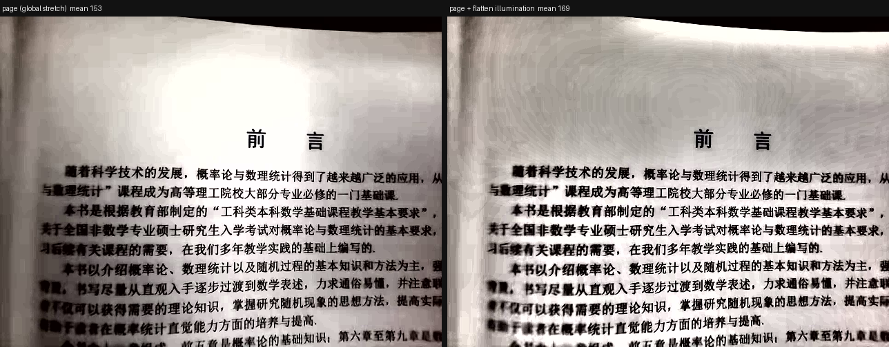

# 上传图片 / 视频到开发板

## 一个窗口，两种文件

双击仓库根目录的 **上传到开发板.bat**（或原来的 上传图片.bat / 上传视频.bat，它们现在都打开同一个窗口）。

选一个文件就行，程序按扩展名判断类型，只显示相关选项：

| 类型 | 扩展名 | 显示的选项 | 按钮 |
|---|---|---|---|
| 图片 | jpg jpeg png bmp tif tiff | 比例、增强挡位、本机提亮、预览效果 | 上传并显示 |
| 视频 | mp4 mov mkv avi m4v webm | 播放方式、帧率、时长 | 开始播放 |
| 动图 | gif webp | 按**帧数**判断：多帧当视频，单帧当图片 | 自动切换 |

把文件拖到图标上会带着路径直接打开。窗口下方的日志显示挡位选择、分段结果和**板子回读的状态**——
出问题先看那里。


一条命令，把电脑上任意一张图放到板子的 HDMI 输出上。

## 用法

```powershell
cd <仓库根目录>
powershell -NoProfile -ExecutionPolicy Bypass -File tools\board\show_image.ps1 -Image C:\path\to\你的照片.jpg
```

预期输出：

```
source 4032x3024 -> 640x480 (letterbox)
wrote <仓库根目录>\.tmp\upload\mine_221308_640x480.png  mean=118.4  min=0  max=255
OK - the board is now showing /tmp/hdmi_uploads/mine_221308_640x480.png
  image=/tmp/hdmi_uploads/mine_221308_640x480.png
  roll=218
  preset=clarity
  sof=1
  mode=640x480
  updated=2025-05-05 23:51:21
```

看到 `OK - the board is now showing ...` 就是成功了，屏幕上的画面会在 1～3 秒内换掉。

## 接口比例（`-Fit`）

| 取值 | 效果 | 适合 |
|---|---|---|
| `letterbox`（默认） | 保持比例，四周用 `-Background` 填边 | 文档、表格、整页扫描 |
| `crop` | 保持比例填满，裁掉溢出部分 | 照片、想填满整屏 |
| `stretch` | 直接拉伸填满 | 不在乎变形 |

```powershell
# 裁切填满，白边用浅灰
... -Image photo.jpg -Fit crop
# 同时切换增强预设
... -Image scan.png -Fit letterbox -Preset binarize
```

`-Background 0..255` 只对 `letterbox` 有效，默认 0（黑色）。

支持的输入格式：Pillow 能读的都行——JPG / PNG / BMP / WEBP / TIFF / GIF。手机拍的竖图会按 EXIF
方向自动转正。**HEIC（iPhone 默认格式）不支持**，先导出成 JPG。

## 让暗图变亮：选对预设

**这不是硬件限制，而是默认预设是 `pass`（恒等，什么都不做）。** 内核里有完整的
局部对比 + 两段色调曲线（`knee` 以下按 `gain_lo` 放大、以上按 `gain_hi`），只是上传路径一直写
`pass`，所以看起来"处理前后一样"。

同一张暗图在板上实测（截取屏幕画面，取平均亮度）：

| 预设 | 低端增益 | 平均亮度 | 观感 |
|---|---|---|---|
| `pass` | 1.0× | **29** | 原样，几乎看不清 |
| `bright` | 3.5× | **96** | 明显变亮，高光基本保留（推荐） |
| `document` | 4.0× | **100** | 更亮，纸面感强 |
| `night` | 4.5× | **104** | 最亮，适合极暗场景 |
| `reading` | 5.5×（knee 低） | 中等 | 保留原味，只提对比 |
| `invert` / `binarize` | — | — | 反色 / 二值化，只适合文字 |

窗口里的「增强」下拉框默认 **自动（推荐）**：它会用 `tools/preview_enhance.py` 把每个预设都算一遍，
按"够亮且不过曝"打分挑一个。暗图通常被挑成 `bright`。

上传前想先看看效果，点 **「预览效果」**：本地生成对比图，不占用开发板，也不会打断像素流。

命令行等价写法：

```powershell
# 自动挑
... -Image photo.jpg -Preset auto
# 指定
... -Image photo.jpg -Preset night
# 只看效果不上板（生成九宫格对比图）
python tools\preview_enhance.py photo.jpg --sheet --out sheet.png
```

**预设只是 59 个配置位，改表不需要重新综合**：`board/hdmi_stream_enhance/hdmi_live.py` 里的
`PRESETS` 与 `tools/preview_enhance.py` 里的表要一致（`tools/check_presets.py` 会检查）。

如果 4.5 倍还不够，需要动内核（例如加 gamma 段），那是一次 HLS + Vivado 重建（约 1 小时）。
当前曲线的极限就在这里：再高的低端增益会把画面大面积推到 255。

## 不用命令行：双击入口

双击仓库根目录的 **上传到开发板.bat**（图片和视频同一个窗口，源码 `tools/board/upload_panel.ps1`）。
窗口里选文件、点「上传并显示」即可；下方日志会回读板上状态。

`UPLOADED` 与 `STATE_IMAGE` 相同，才代表**板上真的换了图**；两个值不同说明常驻进程还没拾取，
窗口会提示「未确认」，等 1–3 秒再看一次。

（旧的 `上传图片.bat` / `上传视频.bat` 也打开同一个窗口，只是预选了类型。）


## 为什么不用重启

板上的常驻演示 `hdmi_resident.py` **独占 VDMA**，而且这个 USB 采集棒有个特性：**像素流一旦中断
就不会自己重新锁定**，只能靠拔插 HDMI 线或重启板子恢复。所以换图不能重启进程，而是走文件接口：

| 文件（板上） | 内容 |
|---|---|
| `/tmp/hdmi_image.txt` | 要显示的图片路径（PNG/JPEG） |
| `/tmp/hdmi_roll.txt` | 水平补偿像素数（启动后由 `fix_offset.ps1` 标定，本次 218） |
| `/tmp/hdmi_preset.txt` | 增强预设（`pass` / `clarity` / `bright` / `night` / `document` / `binarize` / …） |
| `/tmp/hdmi_sof.txt` | SOF 生成开关（`0`/`1`） |
| `/tmp/hdmi_state.txt` | **演示回报的当前状态**（只读） |

这些文件由常驻进程在启动时设成 `666`，上传目录 `/tmp/hdmi_uploads` 设成 `777`，所以 PC 端
**全程不需要 sudo**，重启后也自动生效。

## 排查

| 现象 | 原因与处理 |
|---|---|
| `the resident demo is not running` | 演示没起来。按提示启动一次（只启一次，之后别重启） |
| 状态文件里还是旧图 | 等 3 秒再看；`ssh xilinx@192.168.2.99 cat /tmp/hdmi_state.txt` |
| 屏幕上是彩条 | 采集棒丢了锁定：**拔插 HDMI 线**或重启板子，然后重新启动演示 |
| 图显示为全黑 | 源图太暗；`prepare_image.py` 会打印 `mean=` 提示 |
| 画面偏左/偏右 | 相位属于这一路像素流：运行 `tools\board\fix_offset.ps1` 自动测量并写补偿；视频上传不会再清零标定值（`-Roll` 默认保留）。见 `docs/output_offset.md` |

## 相关文件

- `tools/board/show_image.ps1` —— 一键上传（转换 → 传输 → 切换 → 校验）
- `tools/prepare_image.py` —— 图片转 640×480 PNG，可单独用来预览效果
- `board/hdmi_stream_enhance/hdmi_resident.py` —— 板上常驻演示

## 提亮为什么默认在 PC 侧做

板上增益（`gain_lo`/`gain_hi`）是好的：单实例复核下 1.0× / 1.25× / 1.5× / 2.0× 的列 std
为 1.11 / 3.14 / 2.47（噪声量级），连续 15 分钟 0 次写帧失败。早期看到的"竖条纹"是
**两个演示进程同时写同一份配置字**造成的，不是硬件缺陷
（`board/hdmi_stream_enhance/evidence/gain_defect/README.md`）。

默认仍把提亮放在 PC 侧，理由不是缺陷，而是控制力：PC 能按整张图统计（光照平坦化 + 分位拉伸），
过曝可以预测；板上只有两段线性曲线，参数得事先猜。板上只跑 `clarity`，像素流负担最小；
板端增益仍可随时用，适合演示"同一张图不同曲线"的对比。

| 方式 | 谁在做 | 效果 | 建议 |
|---|---|---|---|
| **本机提亮（默认）** | PC 上的曲线 + 板上 `clarity` 锐化 | 均匀、可预测、无眩光 | ✅ 推荐 |
| 板上增益（`bright`/`night`/…） | FPGA | 提亮更直接，参数固定 | 演示对比时用 |

窗口里 **"在本机提亮（推荐）"默认勾选**；勾选时板上预设自动设为 `clarity`
（只做局部对比增强，把文字边缘拉清楚）。

命令行等价：

```powershell
# 推荐：本机提亮 + 板上锐化
... -Image page.jpg -Fit crop -Tone bright

# 只看板上锐化（不提亮）
... -Image page.jpg -Preset clarity

# 对比：板上增益
... -Image page.jpg -Preset night
```

四种提亮强度：`bright`（默认）、`document`、`reading`、`night`（最亮）。

实测同一张暗书页：亮度 **49 → 171**，屏幕上均匀无条纹。

## 提亮的默认方案：自适应（`page`）

固定增益曲线在纸面上会"按亮度分配亮度"：暗角被放大到纯白，形成眩光块。自适应曲线改为
**量出这张图的墨水位与纸面位**，把它们拉伸到 18..240，纸面因此被钉在固定亮度、整页均匀。

窗口里勾选“在本机提亮（推荐）”即用这条曲线，板上再做局部对比（`clarity`）把笔画边缘拉清。

```powershell
# 默认（自适应）
... -Image page.jpg -Fit crop
# 指定其他曲线
... -Image page.jpg -Tone bright
# 完全不提亮，只上板锐化
... -Image page.jpg -Tone '' -Preset clarity
```

对比（同一张暗书页照片，板上实测）：`reading` 文字最锐但左上角有白斑；`bright` 均匀但偏软；
**`page` 兼顾：文字锐度与 `reading` 相同（强边缘 21.0% vs 21.1%），纸面均匀无眩光**。

## 播放视频

```powershell
# 播放（自动抽帧、上传、切换），默认 30 fps、取前 6 秒
tools\board\play_video.ps1 -Video clip.mp4 -Fps 30 -Seconds 6

# 停止，回到静态图片
tools\board\play_video.ps1 -Video x -Stop
```

- 帧在 PC 上解码后上传；板上按帧率推流，**不重启进程**（重启会打断像素流，需要拔插线）。
- 单帧成本：拷贝 3.4 ms + 写帧 3.4 ms（缓存命中后）；实测 24 fps 请求下 23.3–24.0 fps、0 卡顿。
- 每帧占 DDR 约 0.9 MB：6 秒 @30 fps ≈ 166 MB。
- 控制文件在播放时仍然生效：`echo night > /tmp/hdmi_preset.txt` 会实时换曲线。
- **MP4 需要 ffmpeg**（`winget install Gyan.FFmpeg`）；没有 ffmpeg 时支持 GIF / 动态 WebP。

### 自适应提亮现在会先"平整光照"

只做全局拉伸解决不了**光照不均**：书页左上暗、右上亮时，拉伸只能二选一——保暗处的字就炸亮处，
保亮处就丢暗处的字。所以 `page` 现在分两步：

1. **光照平坦化**：把亮度除以它自己的高斯模糊（σ≈28），低频的光照被除掉，高频的笔画保留；
2. **分位拉伸**：再按 10%/85% 分位把墨水和纸面映射到 18..240。

同一张书页（左：仅拉伸；右：平坦化 + 拉伸）——左边顶部一片惨白、底部字发暗，右边整页均匀：



**代价**：平坦化会让彩色内容略微发灰（它本来就是给文档用的）。彩色照片建议改用 `-Tone bright`。

| 内容类型 | 推荐 |
|---|---|
| 书页、试卷、扫描件、暗处拍的文件 | **`page`**（默认，自动） |
| 普通彩色照片 | `bright` 或 `night`（PC 端曲线；板端增益也可用） |
| 纯文字、要高对比 | `binarize` / `invert` |
