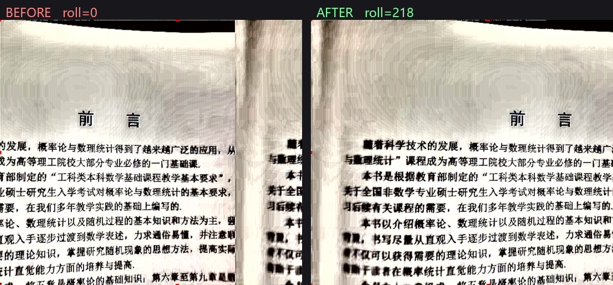

# 输出画面水平偏移：测量、结论、修法

主输出（HDMI OUT）的画面会**整体水平环绕**：不是右边留一条黑边，而是画面从源图的第 W 列开始，
越过右边缘的部分绕回左边。表现为左边少了几厘米的字、右边多出本该在最左边的内容。

一句话结论：**相位是「这一路像素流」的属性，不是画面的属性，也不是每帧重掷的。**
换图、换挡位、常驻进程每 200 ms 的重推都不变；只有像素流重新启动（常驻进程重启 / 板子重启）才变。
所以修法是"启动完演示后测一次"，已经做成一条命令并被启动流程自动调用。

同一台机器、同一个画面（`roll=0` 与 `roll=218`，截图为 OBS 预览按画面区裁切）：



左：画面从源图第 218 列开始，左边的内容绕到右边去了（右边能看到本该在最左边的"随着科…"）。
右：`roll=218` 之后，行首与源图一致。
（图存放在 `board/hdmi_stream_enhance/evidence/offset_before_after.png`。）

## 怎么产生的

`v_axi4s_vid_out` 用 AXI4-Stream 的 `TUSER0`（SOF）把传入的帧对齐到它自己的时基。这条通路上
TUSER 来自 AXI VDMA，而 VDMA 的 `m_axis_mm2s_tuser` 恒为 0；为补上这个缺失的标记，板上加了
`src/rtl/axis_sof_gen`，用 TLAST 计数（每帧 480 行）在帧首产生 TUSER。计数从复位开始数，
于是"哪一行算第一行"取决于**像素流启动时刻**落在哪儿 —— 那就是相位。硬件上改这一点的正解是让
SOF 与真实帧边界严格对齐（或直接把 VDMA 的 TUSER 接出来），需要重建位流；本页记录的是不动位流的修法。

## 怎么量的

八条 80 px 饱和色带（`RED GREEN BLUE YELLOW CYAN MAGENTA ORANGE PURPLE`）铺满 640×480：

1. 只看 OBS 预览（板子的 TMDS 只有采集卡这一个"眼睛"），把 OBS 窗口提到最前、铺满屏幕再截图；
   必须按进程名 `obs64` 找窗口——按标题含 `OBS` 找会抓到**别的**窗口（这个会话标题里就有 `OBS`），
   之前几次"数字对不上"就是这么来的；
2. 每条带用**色相**判读（上传通路的色调曲线只改亮度、不改色相），所以即使挡位不是 `pass` 也认得出来；
   但标定本身把挡位切到 `pass` 且 `-NoTone`，保证颜色是原样；
3. 最左边那条带被切掉多少，就说明画面从源图第几列开始：

   `W = 该带起点 + (80 − 该带可见宽度 / 每源像素的截图像素数)`

   最左带若正好是完整的一条，`W` 就是该带起点（这次实测就是这种情况附近）。

## 2026-10-24 的实测（同一路像素流，一直没重启）

| 动作 | 测得 W（源像素） |
|---|---|
| `roll=0`，刚上传色带 | 216.8 |
| 2 s 后（仅常驻进程 0.2 s 的重推） | 216.8 |
| 只把 `roll` 改成 296（触发"内容变化→重推 4 个缓冲"） | 561.5（= 216.8 − 296 取模 640 ✓ 相位没动） |
| `roll` 改回 0 | 216.8 |
| 再上传两次色带（新文件名 = 真内容变化） | 216.8 / 216.8 |
| 依次切 `clarity / night / document / pass`（每次都会复位内核）后回到 `pass` | 216.8 |
| 写 `roll=37` | 178.8（= 216.8 − 37 ✓） |

结论：**相位在一路像素流内完全稳定**，而且 `roll = W` 就把画面转正了（`display[x] = img[x + W − roll]`）。

> 上一次会话记录的「每帧随机相位（70.9 → 432.0）」不成立：那两次读数用的是抓错窗口的截图，
> 属于测量缺陷，不是硬件行为。本轮所有读数在 ±1 px 内可重复。

对真实画面（书上的一页，640×480）的独立校验：把截图里的画面区与当时推送的 PNG 做归一化互相关，
峰值在 `dx = 0, dy = ~−1` —— 水平已对齐，垂直也没有环绕。

## 视频上传一度把补偿清零（2026-10-24 补记）

上传视频后画面又偏了。原因不是"视频通路没做补偿"——补偿在常驻进程里是**逐帧**应用的
（`frame_pixels = roll_rows(pixels, state["roll"])`），视频和静态图走同一条路。
真正的原因在**上传视频的脚本**：`tools/board/play_video.ps1` 有一个 `-Roll` 参数，默认 `0`，并且在第 3 步
**无条件**执行 `echo $Roll > /tmp/hdmi_roll.txt`。面板调用它时不带 `-Roll`，于是每次上传视频都把标定好的
`218` 写成 `0`，画面立刻跳回 218 px 的环绕——看起来就像"视频的偏移没修"。

    修法：-Roll 的默认值改成 -1 = "保留板上已有的值"，只有显式 -Roll N 才写；
          不带它时会打印 keeping the calibrated compensation (roll=218)，可以在日志里核对。

已验证（同一台机器、同一路像素流）：

| 操作 | 上传后板上 roll | 结果 |
|---|---|---|
| 标定后上传视频（默认参数） | 218（保留） | 画面几何与静态图同一读数，连采 3 次一致 |
| 上传视频并显式 `-Roll 100` | 100 | 覆盖生效（说明参数仍然可用，只是不再默认清零） |
| 标定后上传图片 | 218（本来就不写 roll） | 与之前一致 |

顺带确认：视频的**帧内容**没有额外偏移，`roll=218` 对静态图和视频都成立；相位也不会因为开始/停止播放而改变。

## 怎么修

```powershell
tools\board\fix_offset.ps1            # 测 → 写 /tmp/hdmi_roll.txt → 复测残差 → 还原原来的图和挡位
tools\board\fix_offset.ps1 -Measure   # 只报当前环绕量
```

或者双击根目录的 **set_display_offset.bat**。运行约 10 秒，期间画面会闪一下八色彩条，结束后恢复原画面。

- `tools/board/align_output.py` —— 本体：截图、判读、写补偿、验残差；OBS 窗口用完会放回原位。
- `tools/board/fix_offset.ps1` —— 薄封装，负责找 Python（与 `show_image.ps1` 同一个）。
- `tools/board/ensure_demo.ps1` —— 每次**由它拉起**演示进程后自动跑一次标定；演示本来就在跑时不重复标定
  （相位没变，没必要闪屏）。
- `tools/board/set_roll.ps1` —— 仍然保留：手动给一个值（`-Value N`）或扫掠（`-Sweep`），便于对照。

标定失败（OBS 没开、没在预览采集卡、板子没在推流）时不会改动任何状态：脚本先把 `roll`/图片/挡位记下来，
任何一步失败都按原样写回去，只打印原因。

## 适用范围

位流层面的根治（让 `axis_sof_gen` 与真实帧边界严格对齐，或用 VDMA 的 TUSER）可以把偏移彻底钉死为 0，
但需要重建位流并重新收敛时序（约 35–60 分钟构建 + 上板验证），本次不动；软件标定已经能把残差做到
±1 px，且对"换图/换挡位/播视频"都稳定。
